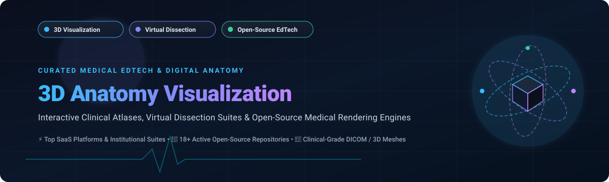

# 🩺 Awesome Medical EdTech & 3D Anatomy Visualization 🧬

  
  
  
  
  
  
  

  <b>A comprehensive, curated directory of world-class Medical EdTech platforms, interactive 3D human anatomy visualization suites, virtual dissection tools, and open-source biomechanical rendering engines. 🚀</b>

---

## 📑 Contents
- [📊 Sector Overview & Market Dynamics](#-sector-overview--market-dynamics)
- [💻 Commercial & SaaS Platforms](#-commercial--saas-platforms)
- [🔓 Open-Source Projects](#-open-source-projects)
- [🤝 Contributing](#-contributing)
- [⭐ Star History](#-star-history)
- [💖 Support](#-support)

---

## 📊 Sector Overview & Market Dynamics

The global **3D Anatomy & Medical Visualization Software** market is estimated at **$2.5B – $2.8B** entering 2025, expanding at a CAGR of ~11.5% driven by the digital modernization of medical school curricula, virtual cadaveric dissection adoption, and 3D clinical pre-operative planning. The sector exhibits **moderate concentration with regional and niche fragmentation**: high-capital academic & enterprise institutional licensing is concentrated around industry heavyweights like Elsevier (Complete Anatomy), Informa/Citeline (Primal Pictures), and Anatomage, while specialized clinical niches (e.g., radiological cross-sectional anatomy via IMAIOS) and freemium student web apps (Kenhub, Visible Body, BioDigital) foster vibrant market variety alongside rapidly maturing open-source WebGL and Blender frameworks. 🌐

---

## 💻 Commercial & SaaS Platforms

Sorted in descending order by parent company size (market valuation / annual company revenue tier). 🏆

| Platform | 🏢 Valuation / Revenue | 💳 Starting Pricing | 🎁 Free Tier / Trial Limit | 🎯 Key Focus & Specialties |
| :--- | :--- | :--- | :--- | :--- |
| **[Primal Pictures (Anatomy.tv)](https://www.primalpictures.com)** | Parent (Citeline / Norstella / Warburg Pincus): **~$4B+** Valuation | **$30.00/month** (single regional modules) or Custom Enterprise/Site License | **Free Trial:** Selected regional demo apps (e.g., Hand/Foot anatomy quiz modules free forever; full suite available via 14-day institutional trial requests) | Scanned 3D human models derived from the Visible Human Project, medical animations, and clinical anatomy curriculum. 🩻 |
| **[Complete Anatomy](https://3d4medical.com/)** | Acquired by Elsevier (RELX) for **$50.6M (€46M)** | **$39.99/year** (Student baseline) / **$99.99/year** (Professional tier) | **3-Day Full-Access Free Trial** across iOS, macOS, Windows, and Android upon account creation | Industry standard 3D interactive human body atlas featuring microscopic models, virtual dissection, radiological cross-sections, and muscle movement simulations. 🫀 |
| **[Anatomage Cloud](https://cloud.anatomage.com/)** | Estimated **$25M – $50M+** Annual Revenue | **$0.00** (Anatomage Cloud baseline viewer) / Hardware systems **$70,000+** | **Free Forever:** Cloud account includes baseline 3D DICOM & mesh uploading, case sharing, and viewing tools (hardware features reserved for Table licenses) | Cloud-based interactive 3D anatomy viewer allowing medical educators to manipulate real human cadaver scan datasets and share cases. 🧠 |
| **[Visible Body Suite](https://www.visiblebody.com/)** | Bootstrapped / Estimated **$10M – $20M+** Annual Revenue | **$44.99/year** (Web & Mobile Suite subscription) | **14-Day Free Trial** on web-based Courseware accounts (iOS/Android provide limited regional preview mode) | Complete macroscopic 3D anatomy, physiology simulations, microanatomy models, pathology units, and augmented reality (AR) modes. 👁️ |
| **[BioDigital Human](https://www.biodigital.com/)** | Venture-backed / Estimated **$5M – $15M** Annual Revenue | **$19.99/month** (Enterprise/Institution custom billed) | **Free Forever Plan:** Includes core A&P library (500+ models) capped at 10 model views/month and 5 model saves to private library | "Google Earth for the human body" cloud WebGL platform designed for embedding interactive 3D anatomical models and disease states into LMS and portals. 🌐 |
| **[IMAIOS e-Anatomy](https://www.imaios.com/en/e-Anatomy)** | Bootstrapped / Scaled to **€5M – €10M+** Annual Revenue | **$13.99/month** or **$94.99/year** (Full personal license) | **Free Forever Tier:** Partial anatomical modules and limited slice exploration per series (full cross-sectional CT/MRI series locked behind subscription) | Premier digital atlas of radiology and human anatomy featuring over 26,000 anatomical structures cross-referenced with high-resolution CT, MRI, and PET scans. 🩻 |
| **[ZygoteBody](https://www.zygotebody.com/)** | Bootstrapped (Zygote Media Group) / Estimated **$3M – $8M** Annual Revenue | **$4.00/month** (Premium tier) / **$98.00/month** (Pro commercial tier) | **Free Forever (Lite Plan):** Basic multi-layered male and female 3D anatomy systems with standard navigation and search | Formerly known as Google Body; high-fidelity layered 3D anatomical models built for web browsing, clinical visualization, and licensing. 🦴 |
| **[Kenhub](https://www.kenhub.com/)** | Bootstrapped / Estimated **$2M – $6M** Annual Revenue | **$39.00/month** (Month-to-month) or **$19.00/month** (Annual billing) | **Free Forever Plan:** Access to basic anatomy articles, standard static atlas plates, and introductory quizzes | Comprehensive medical learning platform offering interactive cross-sectional anatomy, video tutorials, daily histological quizzes, and neuroanatomy atlases. 📚 |
| **[AnatomyZone](https://anatomyzone.com/)** | Independent / Estimated **<$1M** Annual Revenue | **$0.00** (Free platform supported by learning content & donations) | **Free Forever:** 100% free web access to interactive 3D models and over 200+ medical anatomy video tutorials | Freely accessible interactive 3D anatomy resource pairing 3D structural models with comprehensive clinical video explanations. 🩺 |

---

## 🔓 Open-Source Projects

Sorted in descending order by GitHub repository star counts. Star badges link directly to the stargazers of each respective repository. ⭐

| Project | ⭐ Stars | 🛠️ Tech Stack / Format | 📝 Description & Highlights |
| :--- | :--- | :--- | :--- |
| **[wheresryan22/anatomy](https://github.com/wheresryan22/anatomy)** |  | TypeScript, Three.js, WebGL | Lightweight, web-based interactive human anatomy model viewer allowing smooth camera rotations, structural labeling, and isolated muscle/bone inspection. 🔍 |
| **[ashemag/human-atlas](https://github.com/ashemag/human-atlas)** |  | JavaScript, Three.js, BodyParts3D | Open-source 3D human anatomy explorer utilizing BodyParts3D reference geometry; features layer toggling, organ isolation, exploded views, and search. 🗺️ |
| **[thebuggeddev/anatomy](https://github.com/thebuggeddev/anatomy)** |  | Three.js, GLTF, JavaScript | 3D human anatomy viewer built on modern WebGL featuring modular organ-layer rendering and intuitive orbit navigation controls. 🦴 |
| **[Kitware/VTK](https://github.com/Kitware/VTK)** |  | C++, Python, OpenGL | The Visualization Toolkit: the core foundational open-source system for 3D computer graphics, volume rendering, and anatomical medical surface extraction. 🖥️ |
| **[Slicer/Slicer (3D Slicer)](https://github.com/Slicer/Slicer)** |  | C++, Python, Qt | The gold-standard open-source application platform for medical image computing, segmentation, and 3D volumetric anatomical visualization from DICOM CT/MRI datasets. 🔬 |
| **[dipy/dipy](https://github.com/dipy/dipy)** |  | Python, Cython | Diffusion Imaging in Python: 3D tractography, computational anatomy, brain white matter fiber bundle visualization, and neuroimaging analysis. 🧠 |
| **[InsightSoftwareConsortium/itkwidgets](https://github.com/InsightSoftwareConsortium/itkwidgets)** |  | Python, WebAssembly, WebGL | Interactive Jupyter and web widgets for 2D and 3D medical image and anatomical mesh visualization powered by the Insight Toolkit (ITK). 📊 |
| **[Z-Anatomy/Models-of-human-anatomy](https://github.com/Z-Anatomy/Models-of-human-anatomy)** |  | Blender, 3D Assets, CC BY-SA | The most complete open-source 3D human anatomy atlas mapped to Wikipedia definitions; contains comprehensive skeletal, muscular, organ, neural, and circulatory systems. 🎨 |
| **[Kevin-Mattheus-Moerman/BodyParts3D](https://github.com/Kevin-Mattheus-Moerman/BodyParts3D)** |  | STL, MATLAB, Mesh Data | Normalized, binary STL polygon models converted and organized from the foundational BodyParts3D/Anatomography anatomical database mapped to FMA IDs. 📦 |
| **[FreedomIntelligence/BodyVista](https://github.com/FreedomIntelligence/BodyVista)** |  | Vue.js, Three.js, Vite | Interactive web-based 3D human anatomy and oral medicine visualization system with support for pedagogical quiz mode and AI-assisted educational prompts. 🤖 |
| **[sunnychencool/Anatomy3D](https://github.com/sunnychencool/Anatomy3D)** |  | Python, PyTorch | Deep learning codebase for anatomy-aware 3D human body reconstruction and biomechanical pose estimation from monocular video sequences. 🏃 |
| **[mhalle/oabrowser](https://github.com/mhalle/oabrowser)** |  | JavaScript, WebGL | The Open Anatomy Browser (OABrowser): an open-source web viewer for interactive anatomical atlases developed by Brigham and Women's Hospital / Harvard Medical School. 🏛️ |
| **[biocat-ugent/Open-Anatomy-Explorer](https://github.com/biocat-ugent/Open-Anatomy-Explorer)** |  | Angular, WebGL, TypeScript | OPANEX: an interactive 3D web platform for exploring surface-scanned real anatomical specimens, conducting anatomical quizzes, and labeling landmarks. 🧪 |
| **[niuxito/human-body](https://github.com/niuxito/human-body)** |  | Three.js, HTML5 | Minimalist WebGL 3D human body and organ viewer using optimized, compressed geometry derived from BodyParts3D. ⚡ |
| **[SirwanAfifi/anatomy-atlas](https://github.com/SirwanAfifi/anatomy-atlas)** |  | Three.js, JavaScript | Interactive 3D muscle anatomy atlas highlighting major superficial muscle groups and mapping muscle fibers to corresponding physical exercises. 💪 |
| **[Opening-Science/open-twin-xr](https://github.com/Opening-Science/open-twin-xr)** |  | WebXR, Three.js, TypeScript | An open digital twin XR web viewer combining BodyParts3D and Human Reference Atlas (HRA) data for immersive virtual reality anatomy education. 🥽 |
| **[organui/muscles-3d](https://github.com/organui/muscles-3d)** |  | React Three Fiber, Three.js, Vite | Modular, lightweight 3D muscle explorer built with React Three Fiber, isolating muscle groups and skeletal attachments. 🦾 |
| **[organui/skeleton-3d](https://github.com/organui/skeleton-3d)** |  | React Three Fiber, Vite | Clean web viewer dedicated to the human osteological skeleton with individual bone selection and camera focus. 🩻 |

---

## 🤝 Contributing

Contributions, new open-source repositories, and updates to commercial listings are very welcome! 🎉
1. Check the existing directory to avoid duplicates.
2. Ensure open-source projects have active GitHub repositories with valid open licenses.
3. Submit a pull request with clear descriptions following the existing tabular structure.

---

##  Star History
#`
`

---

## 💖 Support

Thank you for visiting and using this curated directory! 🙏 If you found this repository helpful for your studies, teaching, or clinical research, please consider supporting the project:

- ⭐ **Star this repository** to help others discover it.
- 🍴 **Fork and contribute** to keep the list modern and comprehensive.
- 📢 **Share it** with colleagues, medical students, educators, and developers.
- ☕ **Buy a coffee & sponsor**: Support continuous maintenance via the [GitHub Sponsor Dashboard](https://github.com/sponsors/ishandutta2007).
